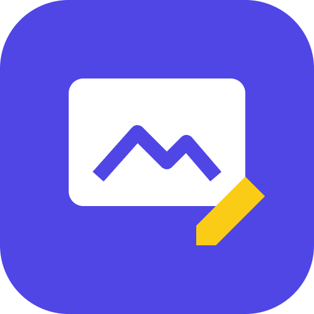
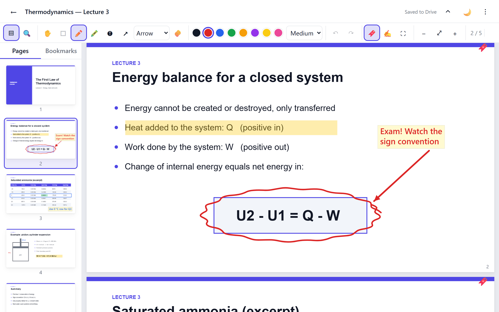
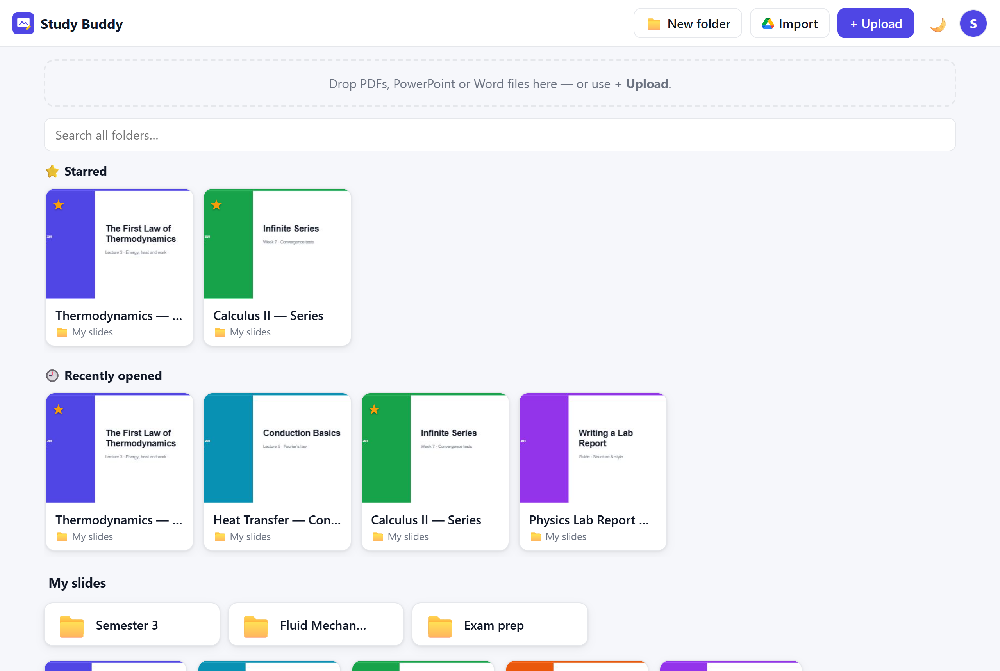
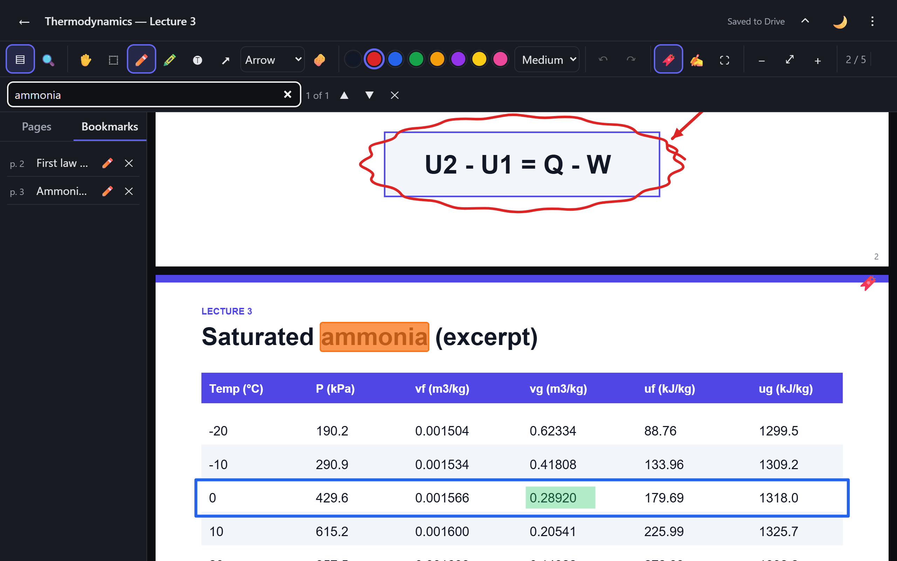
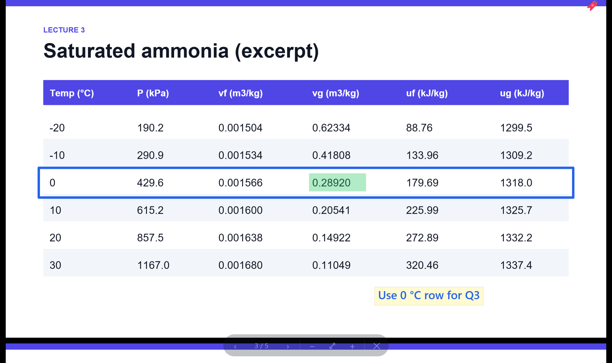
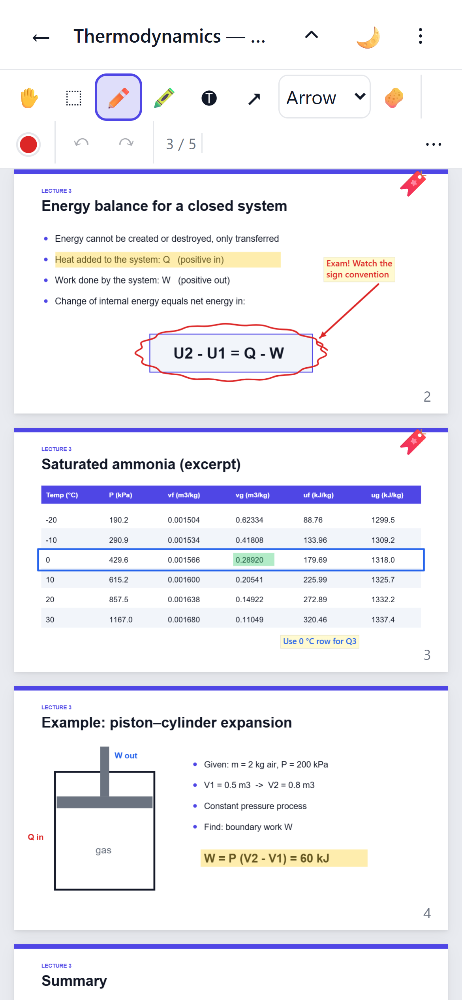
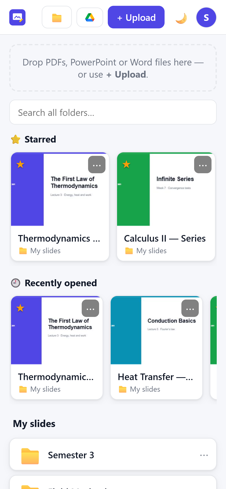

<div align="center">



# Study Buddy

**Upload your lecture slides, annotate them, and pick up where you left off on any device.**
Everything is stored in *your own* Google Drive. There's no backend server and no database.

[**Live app →**](https://my-own-study-buddy.netlify.app) · [Features](#features) · [How it works](#how-it-works) · [Run it yourself](#run-it-yourself)

</div>

<p align="center">
  
</p>

## The idea

Lecture slides tend to end up scattered across downloads, and notes on them get stuck on whichever device they were written on. Study Buddy gives you one place to drop in a PDF or PowerPoint, write on it with a stylus on a tablet, and see the same notes later on a laptop or phone. All of it stays in your own Google Drive instead of another cloud service.

## Features

| | |
|---|---|
| 📤 **Upload anything** | PDF, PowerPoint (`.pptx/.ppt/.odp`) and Word (`.docx/.doc/.odt`). Office files are converted to PDF using Google Drive itself. You can also import files already in your Drive. |
| ✏️ **Annotate** | Pen, highlighter, lines, arrows, rectangles, ellipses, sticky notes you can edit, eraser, and a lasso to select, move and recolour. Undo/redo throughout. |
| ✍️ **Made for tablets** | Stylus mode: the pen draws and your finger scrolls, with palm rejection. Pinch-zoom with any tool. |
| 🔎 **Find things fast** | Searches the slide text with highlighted matches, lets you select and copy slide text, and has a page-thumbnail sidebar and bookmarks. |
| 📁 **Organised like Drive** | Nested folders, rename, move (drag and drop or menu), ⭐ starred, 🕘 recently opened. Name clashes are detected, with *keep both / replace / skip* options. |
| ➕ **Edit the deck** | Insert blank, lined, grid or dotted pages for your own notes, or delete pages. Annotations stay on the right pages. |
| ☁️ **Syncs through Google Drive** | Autosaves about a second after each change and resumes at the page you were reading, on every device. |
| 📴 **Works offline** | Decks you've opened are kept on the device, open instantly, and can be annotated offline. Changes sync when you're back online. |
| 📄 **Export** | Download, or save to Drive, a PDF with your annotations flattened in. |
| 🌗 **Comfortable** | Light/dark theme, focus mode (full-screen slides), a hideable toolbar, and keyboard shortcuts. |
| 📱 **Installable** | A PWA on any platform, and an Android app (Trusted Web Activity). |

<table>
  <tr>
    <td width="50%"></td>
    <td width="50%"></td>
  </tr>
  <tr>
    <td align="center"><sub>Library: folders, starred and recently opened decks</sub></td>
    <td align="center"><sub>Dark theme, text search and bookmarks</sub></td>
  </tr>
  <tr>
    <td></td>
    <td>
      <p align="center">
        
        
      </p>
    </td>
  </tr>
  <tr>
    <td align="center"><sub>Focus mode with zoom controls</sub></td>
    <td align="center"><sub>Phone layout</sub></td>
  </tr>
</table>

## How it works

```
 Browser / Android app                                   Your Google Drive
┌───────────────────────────────┐   drive.file scope   ┌──────────────────────────────┐
│ Vite + vanilla JS             │ ───────────────────▶ │ Study Buddy/                 │
│  • PDF.js  – render + text    │                      │ ├── Semester 3/              │
│  • Canvas  – annotation layer │ ◀─────────────────── │ │   └── Lecture 3.pdf        │
│  • pdf-lib – add pages/export │    REST (fetch)      │ ├── Lecture 4.pdf            │
│  • IndexedDB + Service Worker │                      │ └── _annotations/            │
│    (offline copies)           │                      │     ├── <id> annotations.json│
└───────────────────────────────┘                      │     └── <id>.jpg (thumbnail) │
                                                       └──────────────────────────────┘
```

- **No server.** The app is a static site. It signs in with Google Identity Services and talks to the Drive REST API directly from the browser.
- **Least privilege.** It only asks for the `drive.file` scope, so it can see the files it created (or that you picked with the Google Picker) and nothing else in your Drive.
- **Annotations as data.** Strokes, shapes and notes are stored as JSON in coordinates normalised to the page (0–1). They line up at any zoom level and on any screen, and stay small (a few KB per deck). Folders, names and stars are ordinary Drive metadata (`appProperties`), so moving or renaming files in Drive shows up in the app.
- **Offline first.** PDFs, annotations and listings are cached in IndexedDB. Unsynced edits are kept on the device and pushed when the connection returns. A service worker caches the app itself.
- **Android** uses a Trusted Web Activity: the same web app running full-screen in Chrome, verified with Digital Asset Links. Google sign-in works there, unlike in a plain WebView.

## Tech stack

`JavaScript (ES modules)` · `Vite` · `PDF.js` · `pdf-lib` · `Google Identity Services` · `Google Drive API v3` · `Google Picker` · `IndexedDB` · `Service Worker / PWA` · `Android Trusted Web Activity (Bubblewrap)` · `Netlify`

No UI framework: just DOM APIs, Canvas 2D and CSS custom properties for theming.

## Run it yourself

You need Node.js 18+ and a free Google Cloud project for the sign-in key.

```bash
git clone https://github.com/SafwanSakib/study-buddy.git
cd study-buddy
cp .env.example .env      # add your Google OAuth Client ID
npm install
npm run dev               # http://localhost:5173
```

[`docs/SETUP.md`](docs/SETUP.md) has step-by-step instructions for creating the OAuth client and enabling the Drive API, plus the optional Picker key and deployment to Netlify/Vercel/GitHub Pages.

## Project structure

```
src/
  main.js         app start-up, sign-in flow, routing
  auth.js         Google Identity Services (token model)
  drive.js        Drive REST client: folders, uploads, conversion, annotations, thumbnails
  library.js      folder browser, upload queue, stars, recents, import
  viewer.js       PDF rendering, tools, selection, search, sidebar, zoom, saving
  annotations.js  annotation model: drawing, hit-testing, lasso
  pages.js        insert/delete pages (pdf-lib)
  export.js       flatten annotations into a PDF
  cache.js        IndexedDB offline cache
  thumbs.js, picker.js, theme.js, pdf.js, ui.js
public/           manifest, icons, service worker, Digital Asset Links
android/          Android app (Trusted Web Activity) project
```

## License

[MIT](LICENSE)
